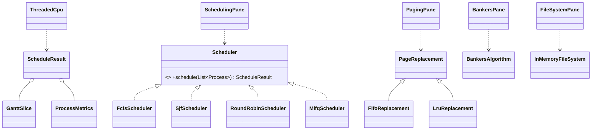

# Mini Operating System Simulator

A JavaFX desktop app that simulates core operating-system ideas: CPU scheduling, page replacement, deadlock
avoidance and a file system. All the logic is in plain Java classes with **no JavaFX code**, so it is fully unit
tested; the `ui` package only draws results.

Built to practise the Operating Systems Design and Computer Hardware modules.

## Features
- **CPU scheduling** - FCFS, SJF (non-preemptive), Round Robin (choose the quantum) and a 3-level
  **MLFQ** (quantum 2 -> quantum 4 -> FCFS, with demotion and preemption by new arrivals)
  - Gantt chart, plus completion, turnaround, waiting and response time per process, averages and CPU utilisation
  - **"Run with threads"** replays the schedule with real Java threads: each process is a thread that waits on
    its own `Semaphore`, and a dispatcher thread hands out the CPU one time slice at a time
- **Page replacement** - FIFO and LRU side by side with frame contents at every step and fault counts
  (the tests also show Belady's anomaly for FIFO)
- **Banker's algorithm** - need matrix, safety check with safe sequence, and resource requests that are
  granted only if the system stays safe (otherwise rolled back)
- **In-memory file system** - directories and files with `mkdir`, `touch`, `write`, `cat`, `ls`, `cd`, `rm`,
  `pwd`, absolute and relative paths (`..`), protected by a `ReentrantReadWriteLock` so it is thread-safe

## Architecture
```
scheduling/  Process, Scheduler (interface), Fcfs/Sjf/RoundRobin/MlfqScheduler,
             ScheduleResult (Gantt + metrics), ThreadedCpu (multithreaded replay)
memory/      PageReplacement (template method) -> FifoReplacement, LruReplacement
deadlock/    BankersAlgorithm
filesystem/  InMemoryFileSystem (tree of nodes + read/write lock)
ui/          JavaFX tabs - one per simulator
```

Design notes:
- New schedulers can be added by implementing `Scheduler` (strategy pattern).
- `PageReplacement` handles frames and faults; subclasses only choose the victim (template method pattern).

## How to run
Requirements: Java 17+ and Maven (JavaFX is downloaded by Maven).
```bash
mvn javafx:run
```

## How to test
```bash
mvn test
```
- `SchedulingTest` - textbook examples for FCFS/SJF/RR, MLFQ demotion and preemption, idle time, all work completed
- `ThreadedCpuTest` - the threads execute in exactly the order of the Gantt chart
- `PagingTest` - textbook fault counts (FIFO 15, LRU 12) and Belady's anomaly
- `BankersTest` - safe sequence, granted / denied requests with rollback, unsafe state
- `FileSystemTest` - paths, errors, shell commands and 8 threads appending concurrently without losing data

## Possible improvements
- Priority scheduling, Optimal page replacement, disk scheduling (SCAN/C-SCAN), saving the file system to disk.
